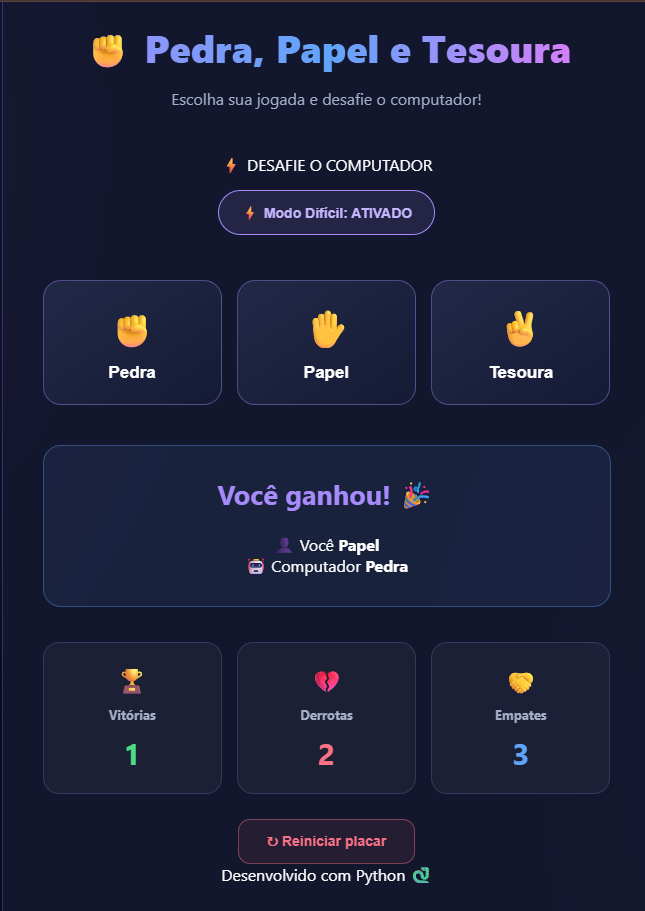

# ✊ Pedra, Papel e Tesoura

Um jogo interativo desenvolvido com Python e Flask, onde o jogador enfrenta o computador em partidas de Pedra, Papel e Tesoura.

## 📸 Demonstração



## 🚀 Funcionalidades

- Escolher entre Pedra, Papel e Tesoura.
- Jogar contra o computador.
- Identificar vitória, derrota ou empate.
- Placar de vitórias, derrotas e empates.
- Reiniciar o placar.
- Interface moderna e responsiva.
- Alternância visual de dificuldade.

## 🛠️ Tecnologias utilizadas

- Python
- Flask
- HTML5
- CSS3
- JavaScript

## 📂 Estrutura do projeto

```text
jogo-pedra-papel-tesoura/
│
├── img/
│   └── tela.png
├── static/
│   └── style.css
├── templates/
│   └── index.html
├── jogo.py
└── README.md